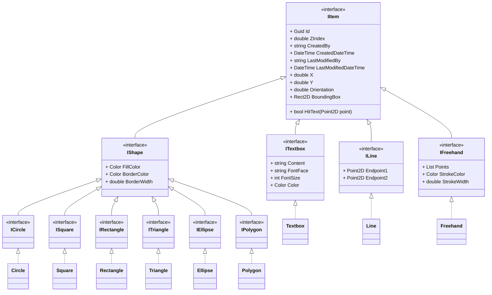
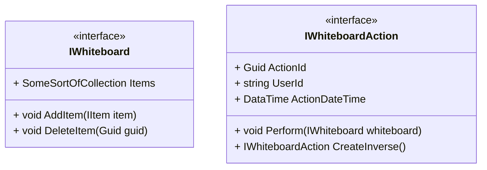
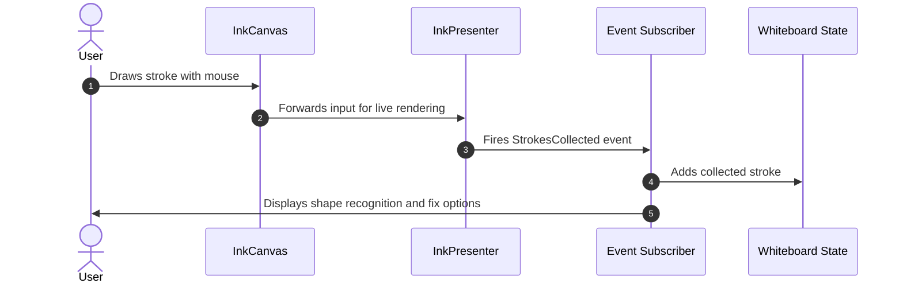

# Planning

## UML Diagrams

## Details

### Models

1. x and y coordinates of every shape are stored in `IItem`.
   Shapes will store information relative to these coordinates.
   When moving a shape, only its x and y coordinates will change.
   This is import, for example, in case of polyline, where we need
   to store the corner coordiantes, which will be relative to these
   x and y coordinates and will not change.
2. Whiteboard is a dictionary from `Guid` to `IItem`

### Taking Freehand input

1. Using [`InkCanvas`](https://learn.microsoft.com/en-us/uwp/api/windows.ui.xaml.controls.inkcanvas?view=winrt-28000) to take user input
2. Using [`InkPresenter`](https://learn.microsoft.com/en-us/dotnet/api/system.windows.controls.inkpresenter?view=windowsdesktop-10.0) to
   statically render strokes
3. Proposed chain of events for strokes and its interaction with whiteboard

### Views

1. Using `Microsoft.UI.XAML.Shapes` [namespace](https://learn.microsoft.com/en-us/windows/windows-app-sdk/api/winrt/microsoft.ui.xaml.shapes?view=windows-app-sdk-2.0)
2. The following views should be there:
   1. All class implementing `IItem`
   2. Toolboxes and its various commands with icons
   3. Hover-tooltips
   4. Restore-buffer

## Further References

1. [How Figma’s multiplayer technology works](https://www.figma.com/blog/how-figmas-multiplayer-technology-works/)
2. [Creating chromeless, non-rectangular Windows from UWP](https://stefanwick.com/tag/desktop-extensions/)
